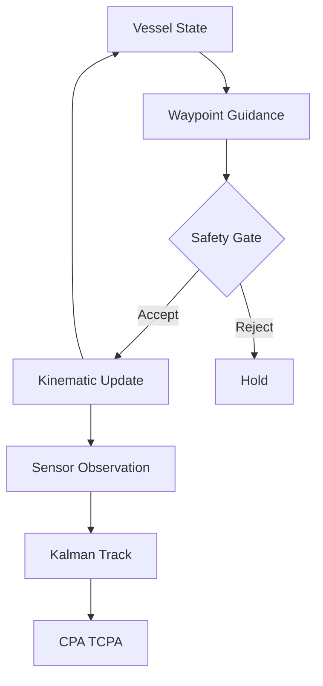
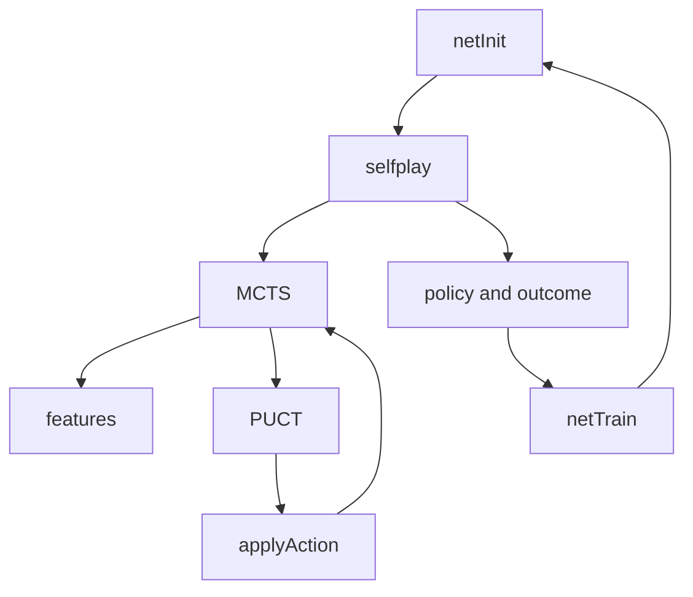

# Sea Hunter Research

<p align="center">
  
  
  
</p>

<p align="center">
  <strong>Maritime autonomy simulation</strong> · <strong>AlphaZero-style Go engine</strong>
</p>

<p align="center">
  
</p>

---

## What this is

This repository is a clean-room research platform for two separate problems:

1. **Maritime autonomy simulation** — a progressive scaffold that starts with a simple kinematic vessel and safety gate, then adds noisy sensors, tracking, and encounter analysis. The animation above shows the basic guidance idea: a vessel following a path toward a waypoint under an independent safety check.
2. **AlphaZero-style Go** — a complete rules engine, a small MLP policy-value network, Monte Carlo Tree Search, and a self-play training loop. Implemented in both MATLAB and C++.

The two threads share no code. They are collected here because both involve sequential decision-making under constraints (safety rules at sea; legal moves on a board).

## Research Context

**Sea Hunter** is an unmanned surface vehicle developed under DARPA’s Anti-Submarine Warfare Continuous Trail Unmanned Vessel (ACTUV) program. The 132-foot (40 m) trimaran was designed and built by Leidos, christened in Portland, Oregon in April 2016, and later transitioned to the Office of Naval Research.

Public program goals included long-endurance autonomous operation (on the order of 60–90 days), sparse supervisory control rather than remote piloting, and compliance with the International Regulations for Preventing Collisions at Sea (COLREGs). The platform was sized for independent deployment and intended primarily for continuous trail of diesel-electric submarines, with modular payloads for other roles.

This repository is inspired by publicly described challenges in maritime autonomy (independent safety gating, sensor observation, tracking, encounter geometry). It does not contain, reverse-engineer, or claim to reproduce any Sea Hunter software, weights, or proprietary design data.

## Table of Contents

- [What this is](#what-this-is)
- [Research Context](#research-context)
- [Installation](#installation)
- [Usage](#usage)
- [Architecture](#architecture)
- [Project Structure](#project-structure)
- [License](#license)

---

## Installation

| Tool | Version |
|------|---------|
| C++ compiler | C++17 |
| CMake | 3.16+ |
| MATLAB | R2023b+ (Go pipeline only) |

---

## Usage

### Maritime Simulation

The maritime code builds two binaries from the repository root:

```bash
cmake -S . -B build
cmake --build build

./build/sim_nav_safety    # Phase 1 — guidance + safety gate
./build/phase_demo        # Phases 2–4 — sensing, tracking, encounters
```

`sim_nav_safety` runs a short closed-loop demonstration of waypoint guidance with an independent safety check. `phase_demo` loads a standard encounter, generates noisy polar observations, updates a Kalman track, and reports CPA/TCPA.

### Go Engine (C++)

```bash
cd cpp
cmake -S . -B build
cmake --build build

./build/az_selfplay 5 50 3   # board size, simulations, games
./build/az_test
```

The C++ self-play binary uses a random evaluator (no trained network). It is useful for exercising the rules engine and search. The Go subtree is also built by default from the repository root.

### Go Engine (MATLAB)

The MATLAB path implements the full trainable loop: feature extraction, MLP forward pass, MCTS with network priors, self-play, and manual backprop training.

```matlab
cfg.N = 5;  cfg.hist = 4;  cfg.sims = 50;  cfg.cpuct = 1.5;
cfg.komi = 6.5;  cfg.maxPlies = 50;  cfg.tauPlies = 10;
cfg.noise = true;  cfg.noiseAlpha = 0.03;  cfg.noiseEps = 0.25;
cfg.seed = 42;

D = (2 * cfg.hist + 1) * cfg.N^2;
A = cfg.N^2 + 1;
H = 64;

P    = az.netInit(D, A, H, cfg.seed);
traj = az.selfplay(P, cfg, 1);
data = struct('xs', traj.xs, 'pis', traj.pis, 'zs', traj.zs);
[P, loss] = az.netTrain(P, data, 10, 0.01, 1e-4);
```

---

## Architecture

### Maritime Pipeline

Guidance and the safety gate are kept separate. A proposed command is checked before it is applied to the kinematic model. Later phases add a noisy polar sensor, a constant-velocity Kalman filter, and encounter geometry (CPA/TCPA).



| Phase | Capability | Binary |
|:------|:-----------|:-------|
| 1 | Kinematic model · guidance · safety gate | `sim_nav_safety` |
| 2–4 | Sensors · tracking · COLREGs fixtures | `phase_demo` |

Details → [`docs/PHASES.md`](docs/PHASES.md)

### Go Pipeline

Self-play generates positions by searching with MCTS. The network provides priors and a value estimate at each leaf. The resulting visit-count policy and game outcome become training targets. The loss is cross-entropy on the policy plus mean-squared error on the value.



PUCT selection uses network priors and root Dirichlet noise. Value backups flip sign with the player to move.

| Module | Path |
|:-------|:-----|
| Rules | `matlab/+go/Board.m` |
| Features | `matlab/+az/features.m` |
| Network | `matlab/+az/net{Init,Forward,Train}.m` |
| Search | `matlab/+az/mcts.m` |
| Self-play | `matlab/+az/selfplay.m` |
| C++ | `cpp/` |

Network structure → [`docs/network_tree.xml`](docs/network_tree.xml)

---

## Project Structure

```text
src/                 Maritime simulation sources
docs/                Design notes, phases, network diagram
matlab/+go/          Go rules engine
matlab/+az/          Features, MLP, MCTS, self-play, training
cpp/                 C++ GoBoard, MCTS, self-play
```

---

## License

Licensed under the **GNU Affero General Public License v3.0 only**. See [LICENSE](LICENSE).
