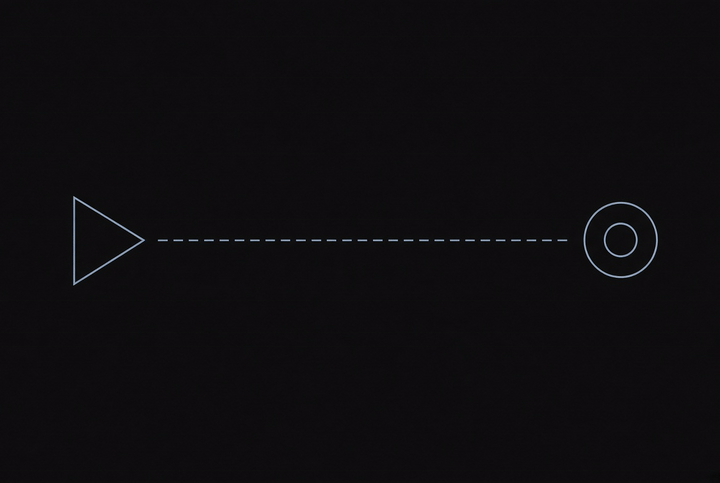
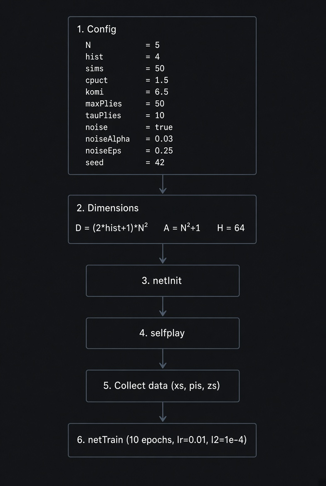
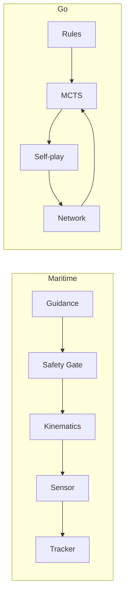
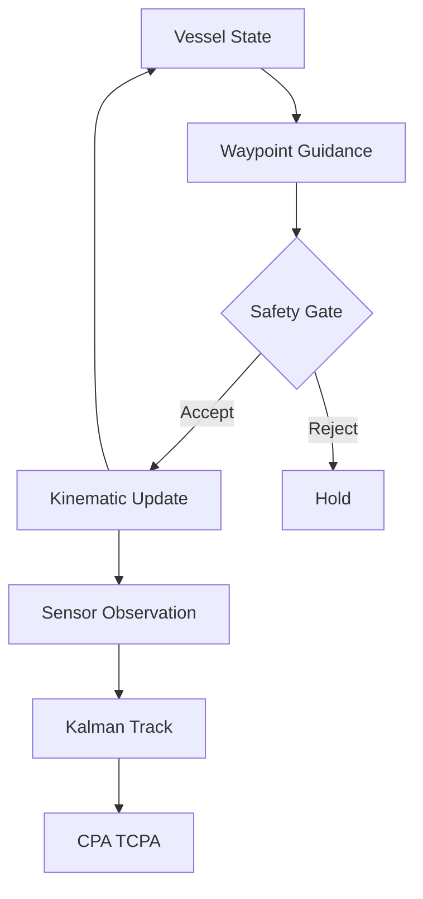
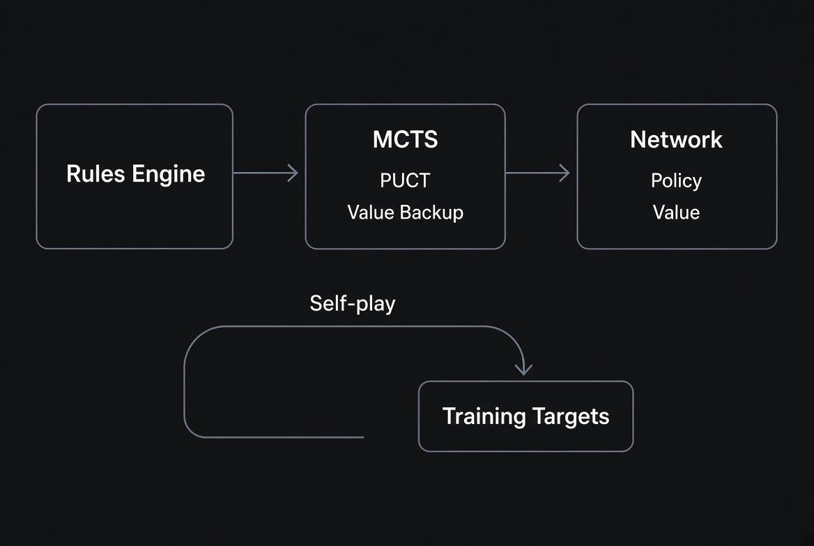
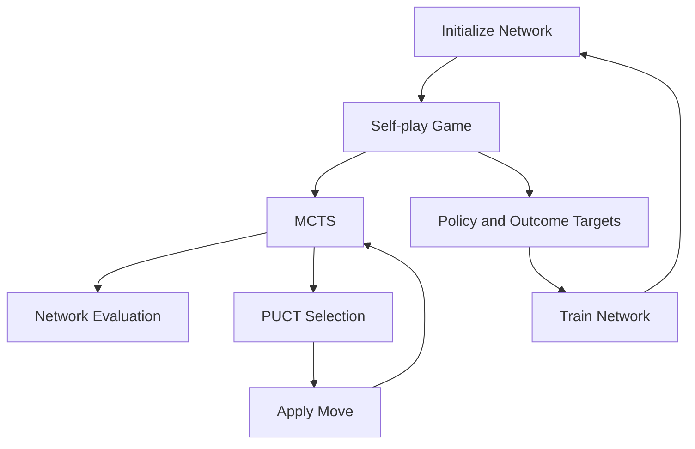

# Sea Hunter Research

<p align="center">
  
  
  
</p>

<p align="center">
  <strong>Maritime autonomy simulation</strong> · <strong>AlphaZero-style Go engine</strong>
</p>

<p align="center">
  
</p>

---

## Overview

This repository contains two independent clean-room research components:

1. **Maritime autonomy simulation.** A progressive kinematic model of an unmanned surface vessel. Guidance produces a proposed command; an independent safety gate accepts or rejects it before the state is advanced. Subsequent stages introduce a noisy polar sensor, a constant-velocity Kalman filter, and encounter geometry analysis (CPA/TCPA). The animation above illustrates the basic closed-loop guidance concept.
2. **AlphaZero-style Go engine.** A rules implementation (area scoring, positional superko), a small multilayer-perceptron policy-value network, Monte Carlo Tree Search with PUCT selection, and a self-play training loop. The same pipeline is available in MATLAB (trainable) and C++ (rules + search).

The components share no source code. They are co-located because both address sequential decision-making under hard constraints.

## Background

**Sea Hunter** is an unmanned surface vehicle developed under the Defense Advanced Research Projects Agency (DARPA) Anti-Submarine Warfare Continuous Trail Unmanned Vessel (ACTUV) program. The 132-foot (40 m) trimaran was designed and constructed by Leidos, christened in Portland, Oregon in April 2016, and subsequently transitioned to the Office of Naval Research.

Publicly stated program objectives included long-endurance autonomous operation (nominally 60–90 days), sparse supervisory control rather than continuous remote piloting, and compliance with the International Regulations for Preventing Collisions at Sea (COLREGs). The vessel was sized for independent deployment and was intended primarily for continuous trail of diesel-electric submarines, with a modular payload architecture supporting additional missions.

This repository is a research scaffold motivated by publicly described problems in maritime autonomy: separation of guidance from safety enforcement, sensor observation under uncertainty, track maintenance, and encounter assessment. It does not contain, reverse-engineer, or claim to reproduce any Sea Hunter software, trained weights, or proprietary design information.

## Table of Contents

- [Overview](#overview)
- [Background](#background)
- [Requirements](#requirements)
- [Usage](#usage)
- [Architecture](#architecture)
- [Repository Layout](#repository-layout)
- [License](#license)

---

## Requirements

| Tool | Minimum Version | Notes |
|------|-----------------|-------|
| C++ compiler | C++17 | g++, clang++, or MSVC |
| CMake | 3.16 | |
| MATLAB | R2023b | Required only for the MATLAB Go pipeline |

---

## Usage

### Maritime Simulation

Configure and build from the repository root:

```bash
cmake -S . -B build
cmake --build build
```

Two executables are produced:

- `sim_nav_safety` — Phase 1 demonstration. A kinematic vessel follows a short waypoint sequence. Each guidance command is evaluated by an independent safety gate before the state is integrated.
- `phase_demo` — Phases 2–4 demonstration. A standard encounter is loaded, noisy polar observations are generated, a constant-velocity Kalman filter maintains a track, and CPA/TCPA are computed from the estimated relative motion.

```bash
./build/sim_nav_safety
./build/phase_demo
```

### Go Engine (C++)

```bash
cd cpp
cmake -S . -B build
cmake --build build

./build/az_selfplay 5 50 3   # board size, simulations per move, games
./build/az_test
```

The C++ self-play binary uses a uniform random evaluator. It exercises the rules engine (including positional superko and the optional dead-stone removal phase) and the MCTS implementation. The `cpp/` subtree is also included by default when configuring from the repository root.

### Go Engine (MATLAB)

The MATLAB implementation provides the complete training loop: history-based feature planes, a two-hidden-layer MLP, MCTS with network priors and root Dirichlet noise, self-play trajectory collection, and minibatch SGD with manually derived gradients.

<p align="center">
  
</p>

---

## Architecture

### System Overview

The repository is organized as two independent stacks. The maritime stack advances a vessel state under a safety-gated guidance loop and optional perception stages. The Go stack implements rules, search, and (in MATLAB) training.



### Maritime

Guidance and safety enforcement are decoupled. A candidate command is generated from the current state and the active waypoint; the safety gate evaluates it independently and either permits the kinematic update or holds the vessel. Later phases introduce a polar observation model with additive Gaussian noise, a constant-velocity Kalman filter for track maintenance, and closed-form CPA/TCPA under a constant-velocity relative-motion assumption.



| Phase | Capability | Executable |
|:------|:-----------|:-----------|
| 1 | Kinematic model, waypoint guidance, independent safety gate | `sim_nav_safety` |
| 2–4 | Polar sensor model, constant-velocity Kalman filter, COLREGs encounter fixtures, CPA/TCPA | `phase_demo` |

Further detail is given in [`docs/PHASES.md`](docs/PHASES.md).

### Go Engine

The Go engine implements an AlphaZero-style agent. Rules, search, and training are separated.

<p align="center">
  
</p>

**Rules.** Area (Tromp-Taylor) scoring, positional superko via board-hash history, suicide ban, and an optional post-pass dead-stone removal phase. Implemented in MATLAB (`+go/Board`) and C++ (`GoBoard`).

**Search.** MCTS with PUCT selection. At each leaf the network returns a policy prior and a value. Root Dirichlet noise is mixed into the prior during self-play. Value backups alternate sign with the player to move. The final visit-count distribution is the policy target.

**Training.** Self-play collects (features, visit policy, outcome) tuples. The network is a two-hidden-layer MLP. Training minimizes cross-entropy on the policy plus mean-squared error on the value, with L2 regularization. Gradients are derived manually.



| Component | MATLAB | C++ |
|:----------|:-------|:----|
| Rules | `+go/Board.m` | `cpp/include/go_board.hpp` |
| Features | `+az/features.m` | — |
| Network | `+az/netInit.m`, `netForward.m`, `netTrain.m` | Random evaluator |
| Search | `+az/mcts.m` | `cpp/src/mcts.cpp` |
| Self-play | `+az/selfplay.m` | `cpp/src/selfplay_main.cpp` |

An alternative Transformer policy-value architecture is described in [`docs/network_tree.xml`](docs/network_tree.xml).

---

## Repository Layout

```text
src/                 Maritime simulation sources
docs/                PHASES.md, network_tree.xml, architecture notes
matlab/+go/          Go rules engine
matlab/+az/          Features, network, MCTS, self-play, training
cpp/                 C++ GoBoard, MCTS, self-play
```

---

## License

This project is licensed under the GNU Affero General Public License v3.0 only. See [LICENSE](LICENSE).
