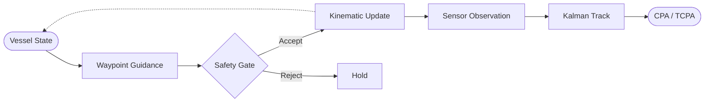
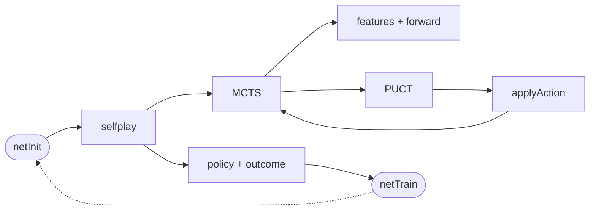

# Sea Hunter Research

<p align="center">
  
  
  
</p>

<p align="center">
  <strong>Maritime autonomy simulation</strong> · <strong>AlphaZero-style Go engine</strong>
</p>

<p align="center">
  
</p>

---

Clean-room research platform with two independent components:

| Component | Focus |
|-----------|-------|
| **Maritime simulation** | Kinematic vessel, safety gate, sensors, tracking, COLREGs fixtures |
| **Go engine** | Rules, MLP policy-value network, MCTS, self-play training |

## Table of Contents

- [Installation](#installation)
- [Usage](#usage)
  - [Maritime Simulation](#maritime-simulation)
  - [Go Engine (C++)](#go-engine-c)
  - [Go Engine (MATLAB)](#go-engine-matlab)
- [Architecture](#architecture)
  - [Maritime Pipeline](#maritime-pipeline)
  - [Go Pipeline](#go-pipeline)
- [Project Structure](#project-structure)
- [License](#license)

---

## Installation

| Tool | Version |
|------|---------|
| C++ compiler | C++17 |
| CMake | 3.16+ |
| MATLAB | R2023b+ (Go pipeline only) |

---

## Usage

### Maritime Simulation

```bash
cmake -S . -B build
cmake --build build

./build/sim_nav_safety    # Phase 1 — guidance + safety gate
./build/phase_demo        # Phases 2–4 — sensing, tracking, encounters
```

### Go Engine (C++)

```bash
cd cpp
cmake -S . -B build
cmake --build build

./build/az_selfplay 5 50 3   # size, sims, games
./build/az_test
```

> The Go subtree is included by default when building from the repository root.

### Go Engine (MATLAB)

```matlab
cfg.N = 5;  cfg.hist = 4;  cfg.sims = 50;  cfg.cpuct = 1.5;
cfg.komi = 6.5;  cfg.maxPlies = 50;  cfg.tauPlies = 10;
cfg.noise = true;  cfg.noiseAlpha = 0.03;  cfg.noiseEps = 0.25;
cfg.seed = 42;

D = (2 * cfg.hist + 1) * cfg.N^2;
A = cfg.N^2 + 1;
H = 64;

P    = az.netInit(D, A, H, cfg.seed);
traj = az.selfplay(P, cfg, 1);
data = struct('xs', traj.xs, 'pis', traj.pis, 'zs', traj.zs);
[P, loss] = az.netTrain(P, data, 10, 0.01, 1e-4);
```

---

## Architecture

### Maritime Pipeline



| Phase | Capability | Binary |
|:------|:-----------|:-------|
| 1 | Kinematic model · guidance · safety gate | `sim_nav_safety` |
| 2–4 | Sensors · tracking · COLREGs fixtures | `phase_demo` |

Details → [`docs/PHASES.md`](docs/PHASES.md)

### Go Pipeline



PUCT selection with network priors and root Dirichlet noise. Value backups flip sign with the player to move. Training loss is cross-entropy on the visit-count policy plus mean-squared error on the outcome.

| Module | Path |
|:-------|:-----|
| Rules | `matlab/+go/Board.m` |
| Features | `matlab/+az/features.m` |
| Network | `matlab/+az/net{Init,Forward,Train}.m` |
| Search | `matlab/+az/mcts.m` |
| Self-play | `matlab/+az/selfplay.m` |
| C++ | `cpp/` |

Network diagram → [`docs/network_tree.xml`](docs/network_tree.xml)

---

## Project Structure

```text
src/                 Maritime simulation
docs/                Design notes and diagrams
matlab/+go/          Go rules
matlab/+az/          Features, network, search, training
cpp/                 C++ Go engine
```

---

## License

Licensed under the **GNU Affero General Public License v3.0 only**. See [LICENSE](LICENSE).
