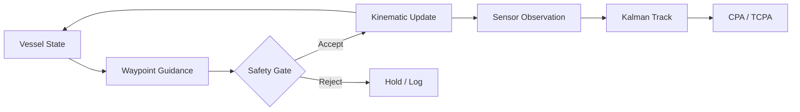
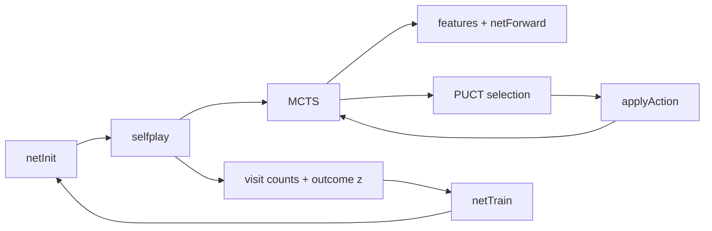

# Sea Hunter Research

[](LICENSE)
[]()
[]()

Research platform for maritime autonomy simulation and AlphaZero-style game-tree search.

The repository contains two independent components:

- **Maritime simulation** — kinematic vessel model, independent safety gate, sensor observation model, constant-velocity tracking, and COLREGs-inspired encounter fixtures.
- **Go engine** — rules implementation (area scoring, positional superko), MLP policy-value network, Monte Carlo Tree Search, and self-play training pipeline.

Both components are clean-room implementations. No proprietary source material is used.

## Table of Contents

- [Installation](#installation)
- [Usage](#usage)
  - [Maritime Simulation](#maritime-simulation)
  - [Go Engine (C++)](#go-engine-c)
  - [Go Engine (MATLAB)](#go-engine-matlab)
- [Architecture](#architecture)
  - [Maritime Pipeline](#maritime-pipeline)
  - [Go Pipeline](#go-pipeline)
- [Project Structure](#project-structure)
- [License](#license)

## Installation

**Requirements**

- C++17 compiler
- CMake 3.16 or later
- MATLAB R2023b or later (MATLAB Go pipeline only)

## Usage

### Maritime Simulation

```bash
cmake -S . -B build
cmake --build build

./build/sim_nav_safety    # Phase 1: guidance and safety gate
./build/phase_demo        # Phases 2–4: sensing, tracking, encounter analysis
```

### Go Engine (C++)

```bash
cd cpp
cmake -S . -B build
cmake --build build

./build/az_selfplay 5 50 3   # board size, simulations, games
./build/az_test
```

The Go subtree is also built by default from the repository root.

### Go Engine (MATLAB)

```matlab
cfg.N = 5; cfg.hist = 4; cfg.sims = 50; cfg.cpuct = 1.5;
cfg.komi = 6.5; cfg.maxPlies = 50; cfg.tauPlies = 10;
cfg.noise = true; cfg.noiseAlpha = 0.03; cfg.noiseEps = 0.25; cfg.seed = 42;

D = (2 * cfg.hist + 1) * cfg.N^2;
A = cfg.N^2 + 1;
H = 64;

P = az.netInit(D, A, H, cfg.seed);
traj = az.selfplay(P, cfg, 1);
data = struct('xs', traj.xs, 'pis', traj.pis, 'zs', traj.zs);
[P, loss] = az.netTrain(P, data, 10, 0.01, 1e-4);
```

## Architecture

### Maritime Pipeline



| Phase | Capability | Binary |
|-------|------------|--------|
| 1 | Kinematic model, waypoint guidance, safety gate | `sim_nav_safety` |
| 2–4 | Sensor model, tracking, COLREGs fixtures | `phase_demo` |

See [`docs/PHASES.md`](docs/PHASES.md).

### Go Pipeline



The search uses PUCT selection with network priors and Dirichlet noise at the root. Value backups alternate sign with player turn. Training minimizes cross-entropy on the visit-count policy plus mean-squared error on the outcome.

| Module | Path |
|--------|------|
| Rules | `matlab/+go/Board.m` |
| Features | `matlab/+az/features.m` |
| Network | `matlab/+az/netInit.m`, `netForward.m`, `netTrain.m` |
| Search | `matlab/+az/mcts.m` |
| Self-play | `matlab/+az/selfplay.m` |
| C++ implementation | `cpp/` |

Network structure: [`docs/network_tree.xml`](docs/network_tree.xml)

## Project Structure

```
src/                 Maritime simulation
docs/                Design notes and diagrams
matlab/+go/          Go rules
matlab/+az/          Features, network, search, training
cpp/                 C++ Go engine
```

## License

This project is licensed under the GNU Affero General Public License v3.0 only. See [LICENSE](LICENSE).
